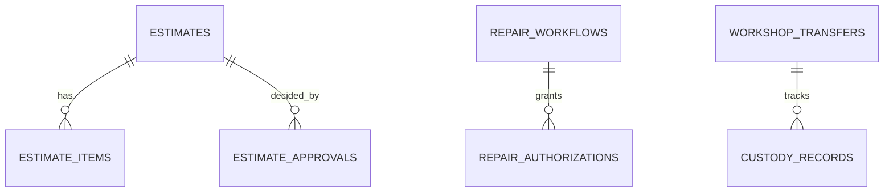

# Database design (Oracle-style, documentation only)
Database-per-service. Cross-service IDs are **logical references**, never cross-schema foreign keys.

```sql
CREATE TABLE ESTIMATES (
  ID VARCHAR2(36) PRIMARY KEY, DIAGNOSIS_ID VARCHAR2(36) NOT NULL, VERSION NUMBER NOT NULL,
  TOTAL_PAISE NUMBER(14) NOT NULL, STATUS VARCHAR2(20) NOT NULL, ROW_VERSION NUMBER DEFAULT 0,
  CONSTRAINT UQ_EST_VER UNIQUE (DIAGNOSIS_ID, VERSION));
```
The in-app Database Explorer lists all 13 schemas, their tables, columns and generated ER diagrams. Complete DDL for every required table is pending (see `IMPLEMENTATION_STATUS.md`).
