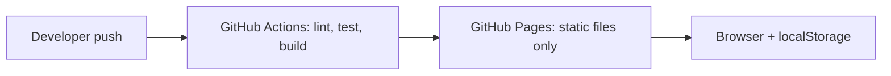
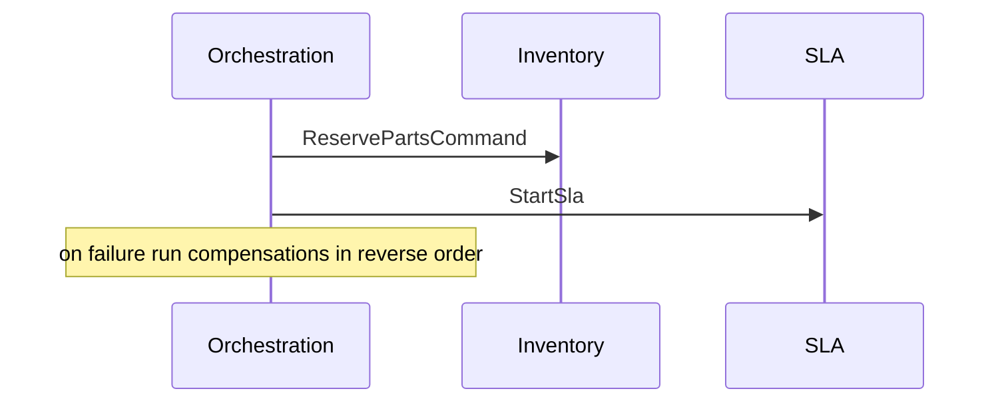

# Diagram index
System context, container, lifecycle, approval, transfer, outbox/Kafka, ER, SLA and failure diagrams live in their respective files in this folder.

The deployment diagram above is the **actual current** deployment. Everything else describes a proposed backend.

