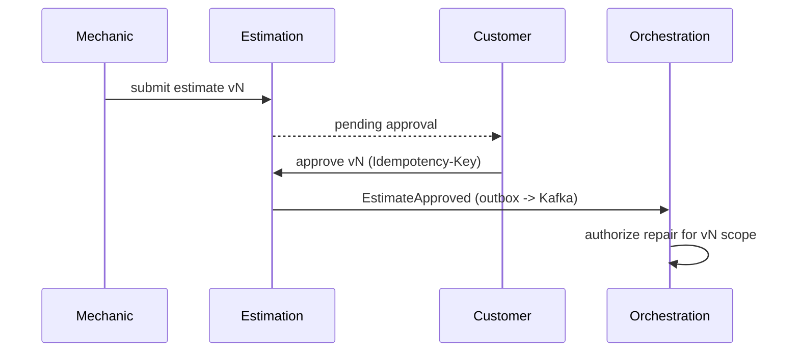

# Estimate approval
Invariants (enforced and tested in the demo): immutable versions; only the current PENDING version may be decided; superseded/expired/already-decided versions are refused; approval ≠ authorization; repair start requires a valid authorization; approval history is append-only.

