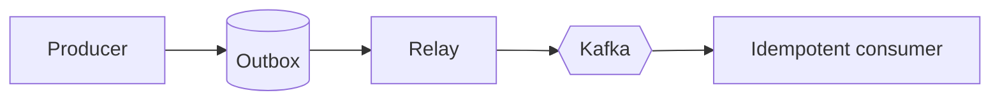

# Event catalog (proposed)
| Event | Publisher | Consumers |
|---|---|---|
| RepairRequested | Repair Request | Dispatch, Audit |
| EstimateSubmitted / Approved / Rejected | Estimation | Orchestration, Inventory, SLA, Notification, Audit |
| RepairAuthorized | Orchestration | Inventory, SLA, Audit |
| TransportAuthorized, WorkshopReceived | Workshop Transfer | Orchestration, Estimation |
| QualityPassed | Quality | Orchestration, Payment |
| InvoiceIssued, PaymentCaptured | Payment | Notification, Analytics |

