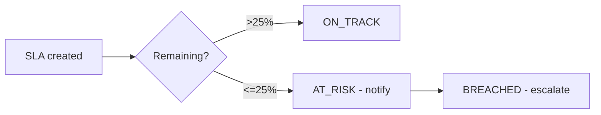

# SLA engine
Implemented as a pure function (`src/domain/sla.ts`): COMPLETED if finished; BREACHED if remaining < 0; AT_RISK if remaining ≤ 25% of target; else ON_TRACK. Extensions are audited with reasons; pause/resume is pending.

