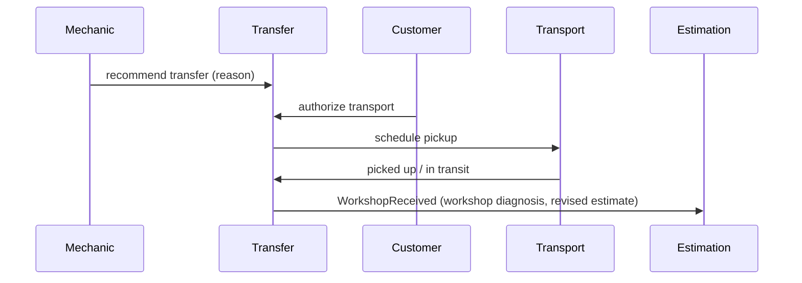

# Workshop transfer
States: REQUESTED → TRANSPORT_AUTHORIZED → PICKUP_SCHEDULED → VEHICLE_PICKED_UP → IN_TRANSIT → WORKSHOP_RECEIVED, plus TRANSPORT_FAILED and CANCELLED. Transport authorization never grants repair permission.

